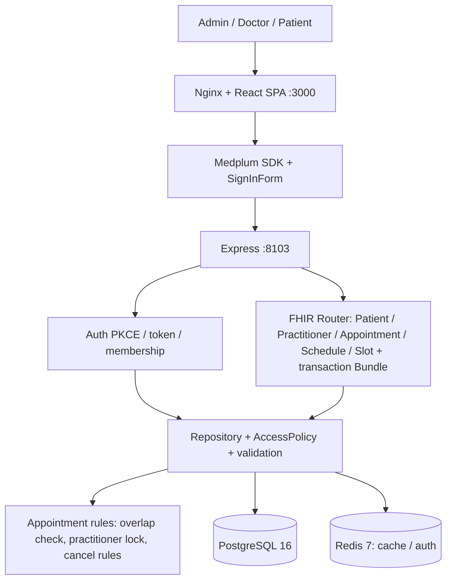
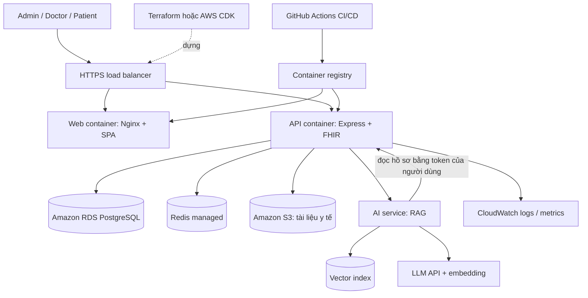

# Kiến trúc hệ thống

Tài liệu chia hai phần: **kiến trúc hiện tại** là những gì đã có trên `main` và chạy được bằng Docker Compose; **kiến trúc mục tiêu** là thiết kế cho tuần 8–14, chưa triển khai. Lộ trình và trạng thái từng tuần nằm ở [PLAN](../PLAN.md).

## Kiến trúc hiện tại (tuần 5–7)

Backend là bản tách modular monolith Medplum 5.2.7. Chế độ demo chạy toàn bộ stack Docker: Nginx phục vụ SPA build bằng Vite, API Node, PostgreSQL và Redis. Seed chạy một lần trước API, chờ database/cache healthy; API chờ seed thành công, web chờ API healthy. Dữ liệu nằm trong named volumes, không bake vào image. Chế độ phát triển có thể chạy API/Vite trên host, chỉ database/cache trong Docker. Chưa triển khai cloud hoặc worker nghiệp vụ. Xem [Docker](../development/DOCKER.md).

| Thành phần | Vị trí                            | Vai trò                                                                      |
| ---------- | --------------------------------- | ---------------------------------------------------------------------------- |
| Web        | `packages/app`, image `web`       | React/TypeScript SPA, dashboard theo vai trò, màn hình bệnh nhân và lịch hẹn |
| API        | `packages/server`, image `server` | Express, auth/OAuth, FHIR router, repository, luật lịch hẹn                  |
| Seed       | `scripts/seed.ts`, image `seed`   | Tạo project, tài khoản demo, Patient, Schedule/Slot, Appointment mẫu         |
| PostgreSQL | service `postgres`                | Lưu FHIR resource, lịch sử phiên bản, bảng lookup; REPEATABLE READ mặc định  |
| Redis      | service `redis`                   | Cache, phiên đăng nhập; bật AOF                                              |

## Dữ liệu

User chứa tài khoản và password bcrypt hash. ProjectMembership nối User, Project và profile. Practitioner là profile nhân viên; admin flag và AccessPolicy xác định quyền quản trị. Patient là hồ sơ bệnh nhân, có thể chưa có tài khoản. CRUD Patient không tự tạo User; invite Patient tạo User/profile/membership liên kết.

Schedule gắn với Practitioner; Slot thuộc Schedule và có trạng thái `free`/`busy`. Appointment.participant.actor tham chiếu Patient/Practitioner, Appointment.slot tham chiếu Slot đã đặt. Repository kiểm tra khoảng thời gian chồng lấn giữa Appointment, giữa Slot trên các Schedule active của cùng Practitioner và giữa Slot với Appointment active, dùng transaction lock theo Practitioner. Patient.generalPractitioner lưu bác sĩ liên quan, chưa dùng làm luật giới hạn Doctor chỉ được xem người được phân công.

Resource lưu JSON serialized trong cột content kiểu TEXT, cùng cột tìm kiếm và lookup. Bảng Resource_History lưu phiên bản. Resource/history/lookup được ghi trong transaction. Xóa mềm trả 410 khi đọc bản hiện tại. Lịch sử phiên bản dữ liệu khác với lịch sử khám bệnh EHR chưa triển khai.

## Lịch hẹn

Admin/Doctor đặt lịch từ Slot trống; Patient chỉ xem lịch trong compartment cá nhân. Đặt lịch gửi một FHIR transaction Bundle: cập nhật Slot thành `busy` và tạo Appointment. Hủy lịch cập nhật Appointment thành `cancelled` và trả Slot về `free` trong cùng transaction.

Repository áp luật cho mọi create/update Appointment có người dùng xác thực, kể cả khi gọi FHIR API trực tiếp:

1. Khóa `pg_advisory_xact_lock` theo project và từng Practitioner tham gia, để hai lượt đặt song song cho cùng bác sĩ chạy tuần tự.
2. Từ chối Appointment có khoảng thời gian giao với lịch đang hoạt động của cùng Practitioner. Lịch `cancelled`, `entered-in-error`, `fulfilled`, `noshow` không tính là trùng.
3. Chỉ cho chuyển sang `cancelled` lịch chưa diễn ra, đang ở `proposed`, `pending`, `booked` hoặc `waitlist`.

Endpoint và mã lỗi nằm ở [API](API.md).

## Auth và quyền

SignInForm lấy project ID công khai, gửi email/password với PKCE, chọn membership nếu cần, đổi code thành access/refresh token và tải auth/me. SDK lưu/khôi phục phiên; logout thu hồi Login ở backend rồi xóa phiên client.

| Khả năng                         | Admin                             | Doctor                       | Patient                     |
| -------------------------------- | --------------------------------- | ---------------------------- | --------------------------- |
| Đăng nhập/dashboard/logout       | Có                                | Có                           | Có                          |
| Tạo/khóa tài khoản và membership | Trong project                     | Không                        | Không                       |
| Patient                          | Trong project                     | Policy Practitioner mặc định | Compartment cá nhân         |
| Practitioner                     | Quản lý cơ bản                    | Policy mặc định; UI xem      | Không có màn hình danh sách |
| Appointment                      | Đặt/hủy trong project             | Đặt/hủy với Slot của mình    | Xem compartment cá nhân     |
| Schedule/Slot                    | Tạo Slot một lần                  | Tạo Slot trong Schedule mình | Không có màn hình           |
| Project khác                     | Không nếu không có liên kết riêng | Không                        | Không                       |

Ma trận là phạm vi demo/UI; backend thực thi policy upstream, không có hệ RBAC song song. Practitioner có quyền ghi nhiều resource nghiệp vụ nhưng không phải project-admin. Menu không thay thế backend authorization.

## Kiến trúc mục tiêu (tuần 8–14, chưa triển khai)

| Tuần | Bổ sung           | Thiết kế dự kiến                                                                                                                                     |
| ---- | ----------------- | ---------------------------------------------------------------------------------------------------------------------------------------------------- |
| 8    | EHR               | Mở Encounter, Condition, Observation qua FHIR router; luật quyền giữ theo AccessPolicy hiện có                                                       |
| 8    | Tài liệu y tế     | File lưu trên S3, metadata và liên kết hồ sơ lưu bằng FHIR resource; API cấp URL tải lên/tải xuống có thời hạn                                       |
| 9–10 | Trợ lý AI         | Pipeline parse → chunk → embedding → vector index; truy xuất rồi gọi LLM, trả lời kèm trích dẫn. Chi tiết: [AI research](../research/AI-RESEARCH.md) |
| 10   | AI theo quyền     | AI đọc hồ sơ qua FHIR API bằng quyền phiên người dùng, không dùng token quản trị, không đưa cả database vào prompt                                   |
| 11   | AWS               | Container chạy trên ECS hoặc EC2, RDS PostgreSQL, Redis managed, S3; mạng private cho database/cache; secrets trong AWS                              |
| 11   | Backup            | Snapshot RDS tự động, thử restore trên môi trường riêng                                                                                              |
| 12   | CI/CD và giám sát | CI hiện có + build/push image, deploy tự động; CloudWatch logs, metrics, alarm                                                                       |

Các lựa chọn còn mở: ECS hay EC2, Terraform hay CDK, model LLM/embedding, nơi lưu vector index. Ghi quyết định vào mục dưới khi chốt.

## Quyết định

1. Tách backend cần thiết và dùng SDK/component npm để hạn chế phần phải bảo trì.
2. Giữ FHIR API và auth upstream, không thêm bảng User hoặc CRUD REST song song.
3. Docker Compose chạy toàn bộ stack demo và build image local; chưa publish registry hoặc triển khai cloud.
4. Project demo bật validate-terminology để từ chối code FHIR không hợp lệ.
5. Tất cả dữ liệu demo giả lập, chỉ dùng localhost.
6. Đặt lịch dựa trên FHIR Schedule/Slot; luật trùng lịch và hủy lịch nằm ở repository để không bị bỏ qua khi gọi API trực tiếp.
7. Chống đặt trùng song song bằng advisory lock theo Practitioner trong transaction, không dùng khóa toàn bảng.
