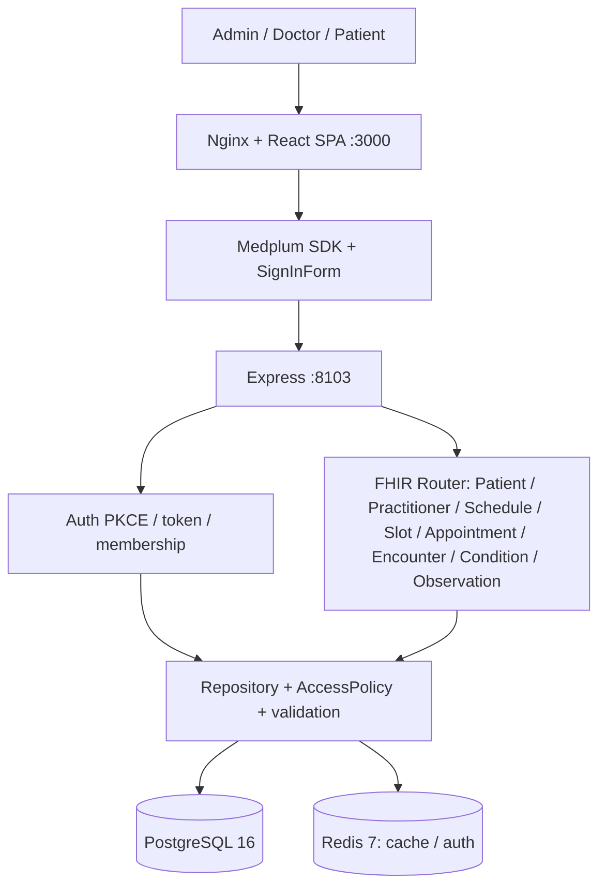

# Kiến trúc tuần 5–6

Backend là bản tách modular monolith Medplum. Chế độ demo chạy toàn bộ stack Docker: Nginx phục vụ SPA build bằng Vite, API Node, PostgreSQL và Redis. Seed chạy một lần trước API, chờ database/cache healthy; API chờ seed thành công, web chờ API healthy. Dữ liệu nằm trong named volumes, không bake vào image. Chế độ phát triển có thể chạy API/Vite trên host, chỉ database/cache trong Docker. Chưa triển khai cloud hoặc worker nghiệp vụ. Xem [Docker](../development/DOCKER.md).

## Dữ liệu

User chứa tài khoản và password bcrypt hash. ProjectMembership nối User, Project và profile. Practitioner là profile nhân viên; admin flag và AccessPolicy xác định quyền quản trị. Patient là hồ sơ bệnh nhân, có thể chưa có tài khoản. CRUD Patient không tự tạo User; invite Patient tạo User/profile/membership liên kết.

Appointment.participant.actor tham chiếu Patient/Practitioner và Appointment.slot có thể tham chiếu Slot. Schedule gắn Slot với Practitioner; repository kiểm tra khoảng thời gian chồng lấn giữa Appointment, giữa Slot trên các Schedule active của cùng Practitioner và giữa Slot với Appointment active, dùng transaction lock theo Practitioner. Patient.generalPractitioner lưu bác sĩ liên quan, chưa dùng làm luật giới hạn Doctor chỉ được xem người được phân công.

Resource lưu JSON serialized trong cột content kiểu TEXT, cùng cột tìm kiếm và lookup. Bảng Resource_History lưu phiên bản. Resource/history/lookup được ghi trong transaction. Xóa mềm trả 410 khi đọc bản hiện tại. API FHIR đã mở Encounter, Condition, Observation và MedicationRequest; app có trang hồ sơ cơ bản, staff ghi resource và Patient đọc lịch sử theo policy/compartment. Staff có thể ghi yêu cầu thuốc với hướng dẫn dùng, lượng cấp phát và số lần cấp thêm. Form Encounter cho phép tham chiếu Appointment đã hoàn tất; chưa có kiểm tra tính nhất quán hai resource hoặc đầy đủ vòng đời lâm sàng và lưu tài liệu cloud. Lịch sử phiên bản dữ liệu khác với lịch sử khám bệnh EHR.

## Auth và quyền

SignInForm lấy project ID công khai, gửi email/password với PKCE, chọn membership nếu cần, đổi code thành access/refresh token và tải auth/me. SDK lưu/khôi phục phiên; logout thu hồi Login ở backend rồi xóa phiên client.

| Khả năng                         | Admin                             | Doctor                       | Patient                     |
| -------------------------------- | --------------------------------- | ---------------------------- | --------------------------- |
| Đăng nhập/dashboard/logout       | Có                                | Có                           | Có                          |
| Tạo/khóa tài khoản và membership | Trong project                     | Không                        | Không                       |
| Patient                          | Trong project                     | Policy Practitioner mặc định | Compartment cá nhân         |
| Practitioner                     | Quản lý cơ bản                    | Policy mặc định; UI xem      | Không có màn hình danh sách |
| Appointment API                  | Trong project                     | Policy mặc định              | Compartment cá nhân         |
| Project khác                     | Không nếu không có liên kết riêng | Không                        | Không                       |

Ma trận là phạm vi demo/UI; backend thực thi policy upstream, không có hệ RBAC song song. Practitioner có quyền ghi nhiều resource nghiệp vụ nhưng không phải project-admin. Menu không thay thế backend authorization.

## Quyết định

1. Tách backend cần thiết và dùng SDK/component npm để hạn chế phần phải bảo trì.
2. Giữ FHIR API và auth upstream, không thêm bảng User hoặc CRUD REST song song.
3. Docker Compose chạy toàn bộ stack demo và build image local; chưa publish registry hoặc triển khai cloud.
4. Project demo bật validate-terminology để từ chối code FHIR không hợp lệ.
5. Tất cả dữ liệu demo giả lập, chỉ dùng localhost.
