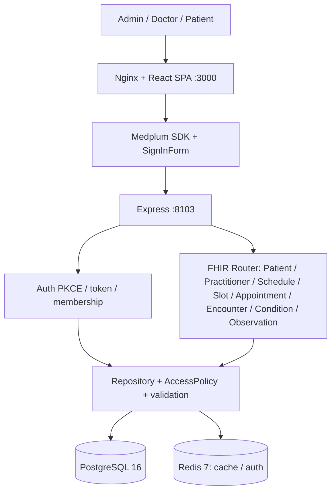

# Kiến trúc tuần 5–6

Backend là bản tách modular monolith Medplum. Chế độ demo chạy toàn bộ stack Docker: Nginx phục vụ SPA build bằng Vite, API Node, PostgreSQL và Redis. Seed chạy một lần trước API, chờ database/cache healthy; API chờ seed thành công, web chờ API healthy. Dữ liệu nằm trong named volumes, không bake vào image. Chế độ phát triển có thể chạy API/Vite trên host, chỉ database/cache trong Docker. Chưa triển khai cloud hoặc worker nghiệp vụ. Xem [Docker](../development/DOCKER.md).

## Dữ liệu

User chứa tài khoản và password bcrypt hash. ProjectMembership nối User, Project và profile. Practitioner là profile nhân viên; admin flag và AccessPolicy xác định quyền quản trị. Patient là hồ sơ bệnh nhân, có thể chưa có tài khoản. CRUD Patient không tự tạo User; invite Patient tạo User/profile/membership liên kết.

Appointment.participant.actor tham chiếu Patient/Practitioner và Appointment.slot có thể tham chiếu Slot. Schedule gắn Slot với Practitioner; repository kiểm tra khoảng thời gian chồng lấn giữa Appointment, giữa Slot trên các Schedule active của cùng Practitioner và giữa Slot với Appointment active, dùng transaction lock theo Practitioner. Staff có thể bắt đầu Encounter từ Appointment arrived/fulfilled; thao tác server-side xác minh Patient, Practitioner được phân công và tạo Encounter liên kết theo transaction khóa Appointment, trả Encounter đã liên kết nếu yêu cầu được gửi lại. Admin gán Patient.generalPractitioner; backend áp dụng tiêu chí đó cho Patient và các resource lâm sàng đang mở qua policy trước khi thực hiện search/read/write. Doctor không thể tạo Patient hoặc sửa trường generalPractitioner; Admin có thể phân công tại hồ sơ Patient. Patient chỉ đọc và cập nhật hồ sơ của chính mình, với phone/email/address là các trường được sửa; backend khôi phục các trường bị khóa kể cả khi giá trị ban đầu là false hoặc 0.

Appointment sau giờ hẹn có thể được staff ghi nhận fulfilled hoặc noshow kèm lý do audit trong comment; các lần hủy tương lai giải phóng Slot và cập nhật Appointment trong cùng transaction. Resource lưu JSON serialized trong cột content kiểu TEXT, cùng cột tìm kiếm và lookup. Bảng Resource_History lưu phiên bản. Resource/history/lookup được ghi trong transaction. Xóa mềm trả 410 khi đọc bản hiện tại. API FHIR đã mở Encounter, Condition, Observation, MedicationRequest, MedicationStatement và AllergyIntolerance; app có trang hồ sơ cơ bản, bản tóm tắt để in hoặc xuất thành FHIR R4 document Bundle preliminary từ FHIR resource đã tải, staff ghi resource và Patient đọc lịch sử theo policy/compartment. Bundle đặt Composition đầu tiên, liên kết các section tới tài nguyên có trong hồ sơ xuất và không tải vượt quyền hiện tại. Encounter đang diễn ra cho phép sửa thời gian bắt đầu và lý do khám; thay đổi được lưu vào note kèm thời điểm và người thực hiện. Ghi chú Encounter có nhãn diễn biến, đánh giá, kế hoạch hoặc thủ thuật trong nội dung Annotation và hiển thị cùng thời điểm/người ghi. Observation có thể được staff sửa về trạng thái amended hoặc đánh dấu entered-in-error; lý do, giá trị trước/sau khi sửa và người thao tác được lưu vào note, giữ nguyên nội dung gốc khi đánh dấu nhập nhầm. MedicationRequest cũng có thể được staff đánh dấu entered-in-error kèm lý do audit mà không xóa thông tin kê đơn. EHR rà soát tham chiếu giữa Encounter, Appointment, Condition, Observation, MedicationRequest và MedicationStatement trong dữ liệu đã tải; tham chiếu chưa tải chỉ là cảnh báo, có thể do quyền truy cập. Condition hỗ trợ xác nhận, bác bỏ, tạm ngưng, tái hoạt và giải quyết; các chuyển trạng thái cần lý do và được lưu vào note audit. Kê đơn và đối soát thuốc lưu liều dạng Quantity, đường dùng và tần suất trong dosage, đồng thời giữ hướng dẫn văn bản tự do; MedicationStatement lưu nguồn bệnh nhân/nhân viên, có thể liên kết MedicationRequest và giữ audit note khi đổi trạng thái. Khi kê đơn, so tên thuốc với tên tác nhân dị ứng dạng văn bản và lưu kết quả cùng xác nhận nhân viên trong audit note; không kiểm tra thành phần, phản ứng chéo hay tương tác. Staff có thể kê thuốc, đối soát thuốc đang dùng/đã ngừng và ghi nhận dị ứng; hồ sơ hiển thị cảnh báo dị ứng đang hoạt động. Form Encounter cho phép tham chiếu Appointment đã hoàn tất; chưa có kiểm tra tương tác thuốc-dị ứng lâm sàng, tính nhất quán lâm sàng toàn diện hoặc lưu tài liệu cloud. Lịch sử phiên bản dữ liệu khác với lịch sử khám bệnh EHR.

## Auth và quyền

SignInForm lấy project ID công khai, gửi email/password với PKCE, chọn membership nếu cần, đổi code thành access/refresh token và tải auth/me. SDK lưu/khôi phục phiên; logout thu hồi Login ở backend rồi xóa phiên client.

| Khả năng                         | Admin                             | Doctor                       | Patient                     |
| -------------------------------- | --------------------------------- | ---------------------------- | --------------------------- |
| Đăng nhập/dashboard/logout       | Có                                | Có                           | Có                          |
| Tạo/khóa tài khoản và membership | Trong project                     | Không                        | Không                       |
| Patient                          | Trong project                     | Policy Practitioner mặc định | Compartment cá nhân         |
| Practitioner                     | Quản lý cơ bản                    | Policy mặc định; UI xem      | Không có màn hình danh sách |
| Appointment API                  | Trong project                     | Policy mặc định              | Compartment cá nhân         |
| Project khác                     | Không nếu không có liên kết riêng | Không                        | Không                       |

Ma trận là phạm vi demo/UI; backend thực thi policy upstream, không có hệ RBAC song song. Practitioner có quyền ghi nhiều resource nghiệp vụ nhưng không phải project-admin. Menu không thay thế backend authorization.

## Quyết định

1. Tách backend cần thiết và dùng SDK/component npm để hạn chế phần phải bảo trì.
2. Giữ FHIR API và auth upstream, không thêm bảng User hoặc CRUD REST song song.
3. Docker Compose chạy toàn bộ stack demo và build image local; chưa publish registry hoặc triển khai cloud.
4. Project demo bật validate-terminology để từ chối code FHIR không hợp lệ.
5. Tất cả dữ liệu demo giả lập, chỉ dùng localhost.
