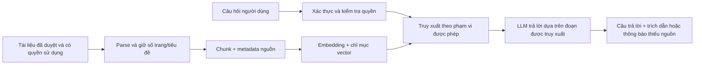

# Khảo sát AI Assistant — đầu ra nghiên cứu tuần 5

Ngày khảo sát: 22/10/2026 (giờ Việt Nam). Đây là tài liệu khảo sát và thiết kế cho tuần 9–10, chưa có chatbot hoặc pipeline RAG được triển khai trong bản tuần 5–6.

## Các phương án LLM

Ứng viên cụ thể để benchmark ở giai đoạn sau: họ **Gemini Flash** qua API, họ **Claude Sonnet** qua API và **Qwen3-4B** chạy local qua Ollama. Đây là danh sách khảo sát, chưa phải model đã tích hợp hoặc kết quả đánh giá y khoa. Nguồn xác nhận dòng model: [Gemini models](https://ai.google.dev/gemini-api/docs/models), [Claude models](https://platform.claude.com/docs/en/models/overview), [Qwen3-4B trên Ollama](https://ollama.com/library/qwen3:4b). Chọn model ID còn được cung cấp tại thời điểm triển khai, không hardcode một alias trong thiết kế tuần 5.

| Phương án                     | Khả năng được tài liệu nhà cung cấp mô tả                                                     | Điểm nhóm cần thử nghiệm                                                                                 |
| ----------------------------- | --------------------------------------------------------------------------------------------- | -------------------------------------------------------------------------------------------------------- |
| Gemini qua API                | Có nhiều model sinh nội dung và API embedding; có thể tách model trả lời khỏi model embedding | Chất lượng tiếng Việt, độ trễ, quota, chi phí trên bộ câu hỏi cố định và chính sách xử lý dữ liệu        |
| Claude qua API                | Hỗ trợ trích dẫn đến đoạn hoặc vị trí trong tài liệu được cung cấp                            | Độ chính xác trích dẫn và chi phí với ngữ cảnh dài; embedding cần lựa chọn riêng                         |
| Mô hình chạy local qua Ollama | Có API embedding phục vụ semantic search/RAG                                                  | Model sinh nội dung, license của từng model, RAM/VRAM, tốc độ và chất lượng tiếng Việt trên máy của nhóm |

Nguồn đã tra cứu: [Gemini models](https://ai.google.dev/gemini-api/docs/models), [Gemini embeddings](https://ai.google.dev/gemini-api/docs/embeddings), [Claude citations](https://platform.claude.com/docs/en/build-with-claude/citations), [Ollama embeddings](https://docs.ollama.com/capabilities/embeddings). Khả năng có trích dẫn không tự chứng minh câu trả lời đúng y khoa. Chưa có benchmark của nhóm; không ghi nhà cung cấp nào tốt nhất hoặc rẻ nhất.

Quyết định hiện tại: thiết kế adapter cho model sinh nội dung và embedding độc lập, chưa khóa model hoặc mua dịch vụ. Trước tuần 9, so sánh các model đang sẵn có bằng cùng tài liệu, prompt và tập đánh giá. Chỉ dùng dữ liệu giả lập hoặc tài liệu được phép sử dụng trong thử nghiệm đầu tiên.

## Cách RAG hoạt động và thiết kế dự kiến

[Nghiên cứu RAG của Lewis và cộng sự](https://arxiv.org/abs/2005.11401) kết hợp mô hình ngôn ngữ với khả năng truy xuất một kho thông tin bên ngoài. Với đồ án, kiến trúc dưới đây là đề xuất của nhóm, chưa phải kết quả triển khai:

Metadata tối thiểu của tài liệu: ID, tiêu đề, cơ quan/tác giả, URL, ngày xuất bản/cập nhật, ngày thu thập, license, ngôn ngữ, phiên bản và vị trí đoạn/trang. Giữ liên hệ chunk → nguồn để kiểm tra trích dẫn. Thử nghiệm chunk theo mục/đoạn trước; kích thước, overlap, top-k và ngưỡng truy xuất được chọn qua đánh giá, không coi số tùy ý là tối ưu.

Kho kiến thức công khai và dữ liệu hồ sơ bệnh nhân là hai nguồn khác nhau. Tuần 9 chỉ tra cứu tài liệu. Tuần 10, nếu bổ sung tóm tắt bệnh án, dữ liệu phải được đọc qua FHIR bằng quyền của phiên người dùng; không đưa token quản trị hoặc toàn bộ database vào prompt. Tài liệu truy xuất được coi là dữ liệu, không phải chỉ dẫn có quyền thay đổi policy.

## Nguồn y khoa có thể xem xét

| Nguồn                                  | Mục đích                                                | Điều kiện trước khi nhập vào corpus                                                                                     |
| -------------------------------------- | ------------------------------------------------------- | ----------------------------------------------------------------------------------------------------------------------- |
| MedlinePlus/NLM                        | Thông tin sức khỏe phổ thông cho bệnh nhân              | Chọn đúng phần public-domain; nội dung bên thứ ba trên cùng website có thể có copyright riêng                           |
| NCBI Bookshelf                         | Tài liệu sách/chuyên khảo, ưu tiên nội dung open access | Kiểm tra license từng tài liệu; dùng kênh Open Access Subset cho tải tự động được cho phép, không crawl toàn bộ website |
| Tài liệu nhóm được giảng viên cung cấp | Corpus nhỏ, phù hợp nội dung demo tiếng Việt            | Ghi tác giả, phiên bản, quyền sử dụng và phạm vi câu hỏi; không coi tài liệu chưa duyệt là hướng dẫn điều trị           |

Nguồn về quyền sử dụng: [MedlinePlus content reuse](https://www.medlineplus.gov/about/using/usingcontent/), [Bookshelf copyright và giới hạn tải tự động](https://www.ncbi.nlm.nih.gov/sites/books/about/copyright/). Chưa tải hoặc tái phân phối corpus trong repo này.

## Kế hoạch đánh giá tuần 9–10

Chuẩn bị tối thiểu 20 câu hỏi có đáp án và đoạn nguồn đối chiếu: 8 câu tra cứu trực tiếp, 4 câu tổng hợp nhiều đoạn, 4 câu không có đáp án trong corpus, 2 câu chứa chỉ dẫn độc hại trong tài liệu và 2 câu yêu cầu dữ liệu hồ sơ trái quyền. Có người kiểm tra đáp án, không dùng một model làm tiêu chuẩn duy nhất.

Đo retrieval Recall@k, tỷ lệ trích dẫn hỗ trợ đúng phát biểu, tỷ lệ trả lời khi thiếu nguồn, độ trễ p50/p95, token/chi phí thực tế nếu dùng API và tỷ lệ lộ dữ liệu trái quyền (yêu cầu bằng 0). Ghi rõ phần chưa benchmark. Trợ lý dự kiến hỗ trợ tra cứu và tóm tắt trong đồ án; không tự kê đơn hoặc thay thế quyết định của bác sĩ.
